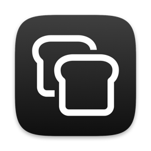
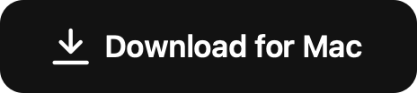
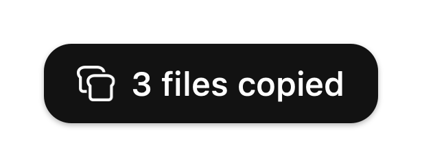

<p align="center">
  
</p>

<h1 align="center">copyToast</h1>

<p align="center">
  A tiny toast when you copy files, folders, or paths in Finder.
</p>

<p align="center">
  <a href="https://github.com/alexgurgulescu/copyToast/releases/latest/download/copyToast.dmg">
    <picture>
      <source media="(prefers-color-scheme: dark)" srcset="docs/images/download-dark.png">
      
    </picture>
  </a>
</p>

<p align="center">
  Free and open source · macOS 15.4 or later · Apple Silicon and Intel
</p>

<p align="center">
  <picture>
    <source media="(prefers-color-scheme: dark)" srcset="docs/images/toast-dark.png">
    
  </picture>
</p>

Finder gives no feedback when you press ⌘C or ⌥⌘C. copyToast shows a small message such as "Path copied" or "3 files copied" and then gets out of your way.

## Install

1. [Download copyToast](https://github.com/alexgurgulescu/copyToast/releases/latest/download/copyToast.dmg), open it, and drag copyToast to Applications.
2. Open copyToast from Applications. macOS will block it the first time.
3. Go to **System Settings → Privacy & Security**, scroll down, click **Open Anyway**, and confirm.

Look for the toast icon in your menu bar. If macOS asks whether copyToast can paste from other apps, choose **Allow** so it can count what you copied.

**Why the extra step?** copyToast is a free project and isn't notarized by Apple, which requires a paid developer membership. The full source code is here, and the app has no network access.

**Download it only from this repository.** Because macOS can't verify copyToast for you, avoid copies hosted anywhere else. See [SECURITY.md](SECURITY.md) to verify a download or report a problem.

## What it shows

| You copy | Toast |
| --- | --- |
| One file | File copied |
| Several files | 3 files copied |
| One folder | Folder copied |
| Several folders | 2 folders copied |
| Files and folders | 3 files and 2 folders copied |
| One path (⌥⌘C) | Path copied |
| Several paths (⌥⌘C) | 4 paths copied |

Other text, such as part of a file name while renaming, shows nothing.

## Features

- Lives in the menu bar, with no Dock icon
- Works with Copy (⌘C) and Copy as Pathname (⌥⌘C)
- Never takes focus, and clicks pass through the toast
- Adapts to light and dark mode
- Respects Reduce Motion
- Stays out of screenshots and screen sharing, although some recording apps may not honor this
- Menu options for Pause, Launch at Login, About, and Quit

## Privacy

copyToast is designed to know as little as possible:

- **No network access.** The App Sandbox is on without the network permission.
- **No keyboard monitoring.** It reacts only to clipboard changes and needs no Accessibility or Input Monitoring permission.
- **Minimal clipboard reading.** It inspects the clipboard only when it changes while Finder stays the frontmost app. macOS doesn't say which app made a copy, so a background app's copy can be counted too. It counts items and never displays or keeps their contents.
- **No storage, logs, or analytics.**
- **Skips sensitive copies.** Items that password managers and other apps mark as concealed or temporary are ignored.
- **No third-party dependencies.**

## Support

copyToast is free. If it's useful to you, you can [buy me a coffee](https://buymeacoffee.com/alexgurgulescu).

## Known limitations

- A single copied path that goes through a folder whose name ends in a space may be counted as more than one path.

## Build from source

You need macOS 15.4 or later, Xcode 16 or later, and a free Apple Development certificate, which you can create in Xcode under Settings → Apple Accounts → Manage Certificates.

```bash
git clone https://github.com/alexgurgulescu/copyToast.git
cd copyToast
./scripts/build.sh
cp -R build/copyToast.app /Applications/
open /Applications/copyToast.app
```

Install the app in Applications before turning on **Launch at Login**.

### Development

```bash
swift test                    # Run the tests
./scripts/build.sh            # Build and sign build/copyToast.app
./scripts/make-dmg.sh         # Build a universal, ad hoc signed DMG
swift scripts/make-icon.swift # Regenerate the app icon
```

A manual test checklist is in [TESTING.md](TESTING.md).

## License

copyToast is free for private and commercial use under the [MIT License](LICENSE). Please keep the copyright and license notice in copies of the software.

The coffee icon is from [Lucide](https://lucide.dev), under the ISC License. See [THIRD_PARTY_NOTICES.md](THIRD_PARTY_NOTICES.md).
